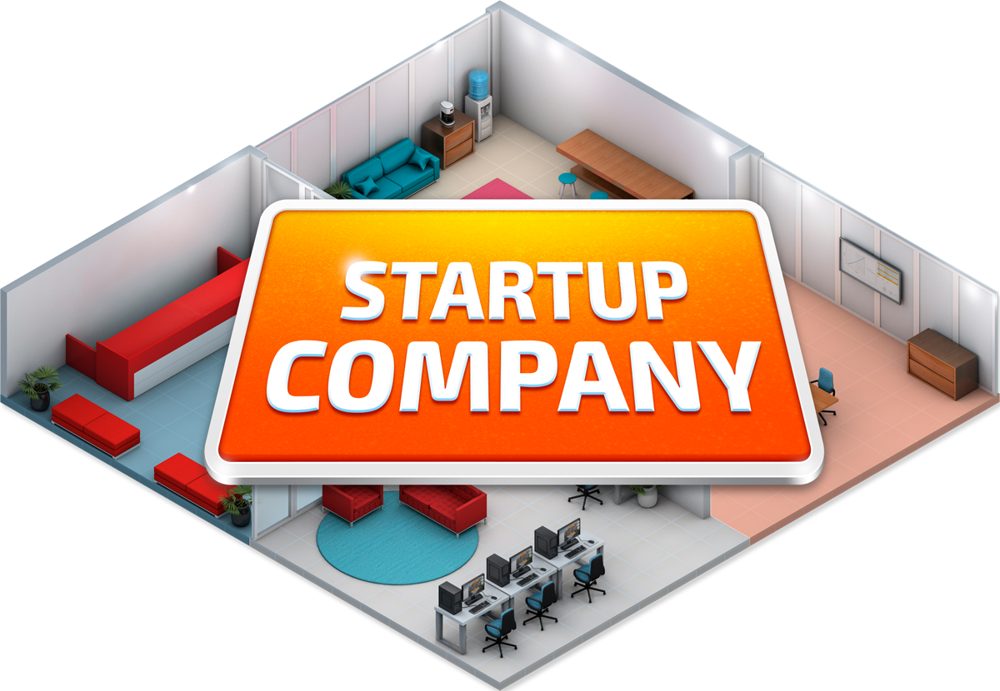
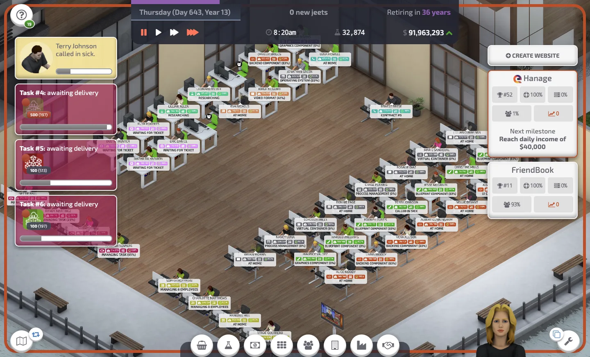
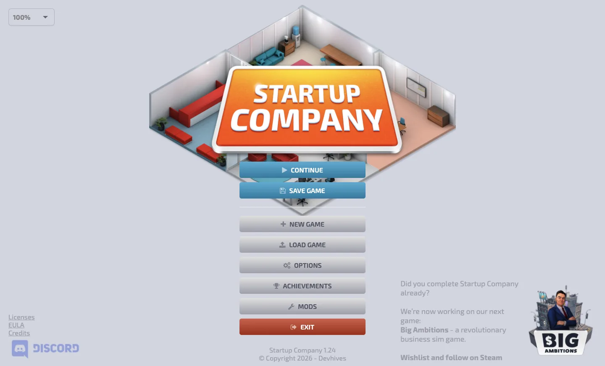
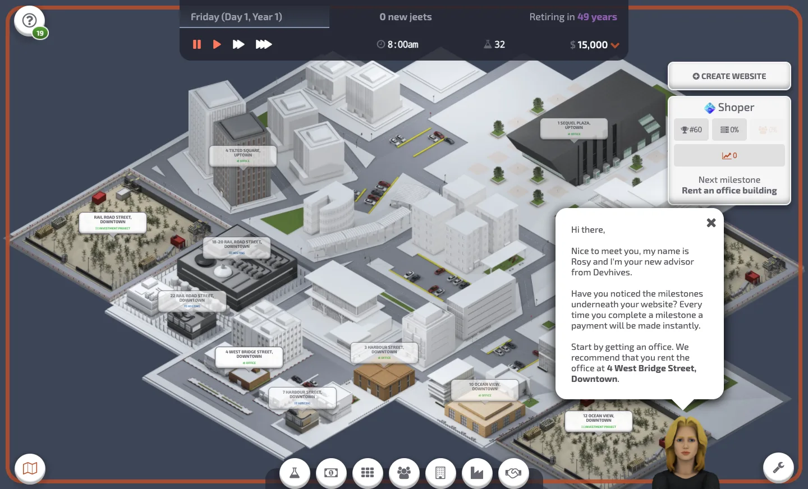
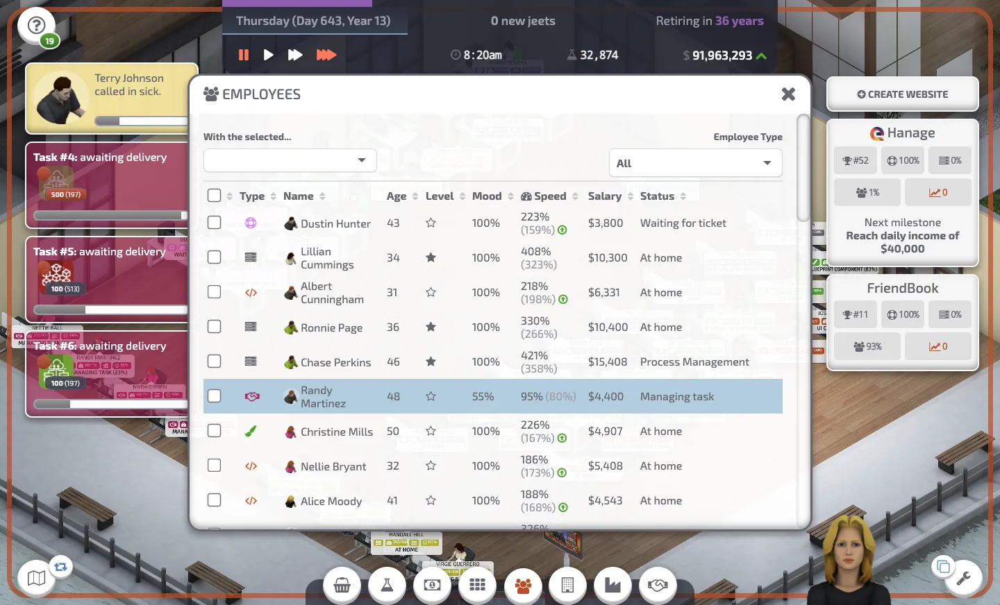
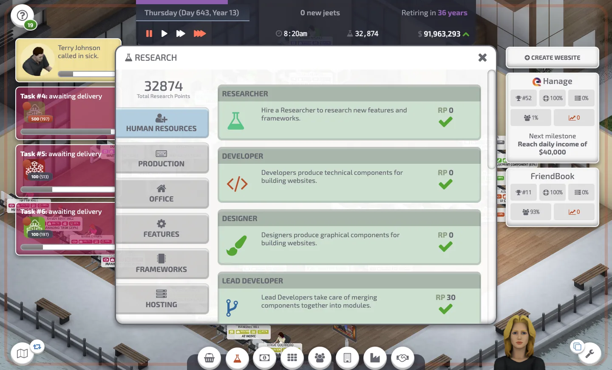
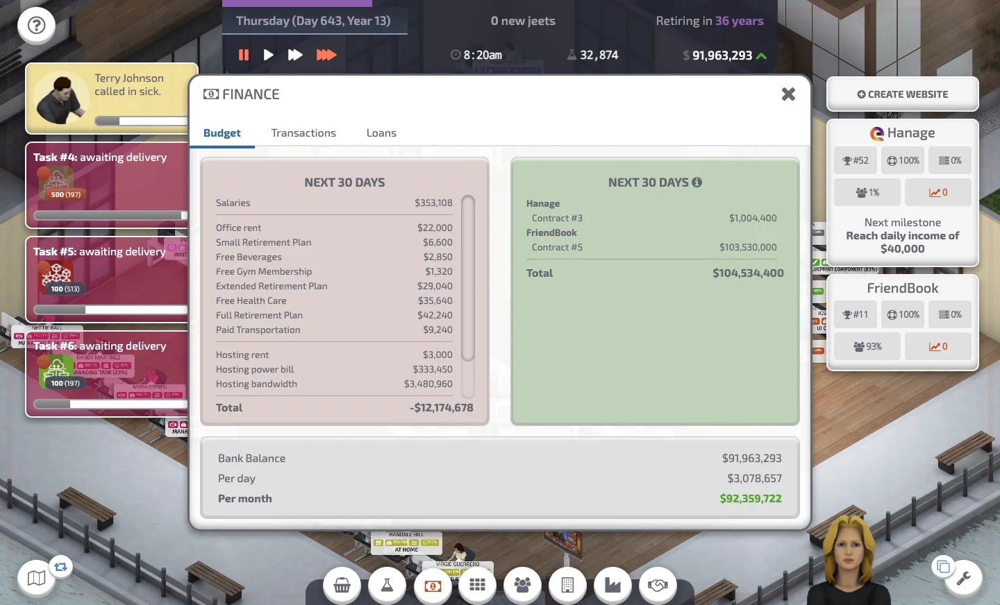
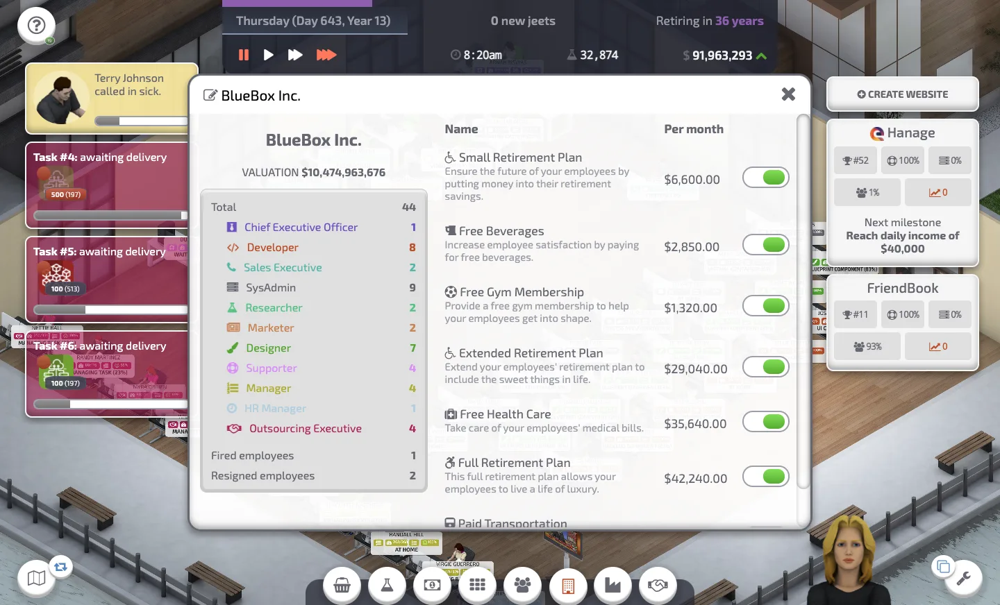
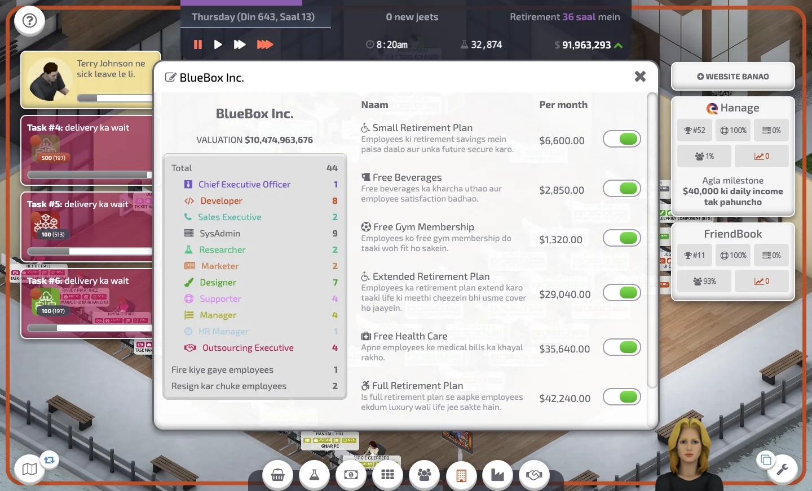
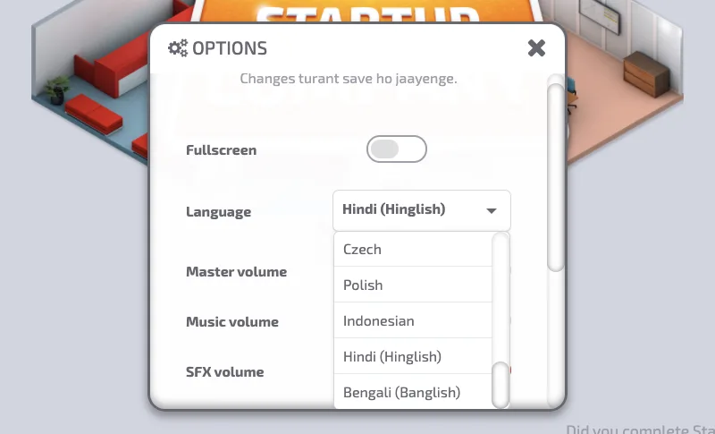

<div align="center">



# Startup Company — macOS, Linux & Windows

**Build a tech startup from a tiny desk to a billion-dollar empire.**<br>
Hire a team, ship websites, run your own servers, fight the competition, and retire rich.




</div>

---

## Contents

- [About the game](#about-the-game)
- [Screenshots](#screenshots)
- [Quick start](#quick-start)
- [Game modes](#game-modes)
- [Controls](#controls)
- [Languages](#languages)
- [Bundled mods](#bundled-mods)
- [Troubleshooting](#troubleshooting)
- [Project structure](#project-structure)
- [License](#license)

## About the game

You start with one desk and $15,000. Your goal is to retire with the biggest possible fund.

|                        |                                                                                               |
| ---------------------- | --------------------------------------------------------------------------------------------- |
| 🏢 **Grow the office** | Rent bigger buildings, buy desks and furniture, keep your team happy.                         |
| 👩‍💻 **Hire a team**     | Developers, designers, lead developers, marketers, SysAdmins, managers, researchers and more. |
| 🌐 **Ship websites**   | Social media, video sharing, e-commerce and more — add features and frameworks as you grow.   |
| 🖥️ **Run the hosting** | Build server racks, manage cooling and power, survive DDoS attacks.                           |
| 🤝 **Make deals**      | Negotiate ad contracts, take investor money, or buy out your investors.                       |
| 📈 **Beat the rivals** | Compete for users and climb to #1.                                                            |

The game runs in real time with a day/night cycle. Each day your team works, servers run, contracts tick down and your bank balance moves. Play at 1×, 2× or 3× speed.

## Screenshots

<table>
  <tr>
    <td width="50%"><br><sub><b>Main menu</b></sub></td>
    <td width="50%"><br><sub><b>City map</b> — pick your first office</sub></td>
  </tr>
  <tr>
    <td><br><sub><b>Employees</b> — speed, mood, salary and status</sub></td>
    <td><br><sub><b>Research</b> — unlock roles, features and frameworks</sub></td>
  </tr>
  <tr>
    <td><br><sub><b>Finance</b> — costs and income for the next 30 days</sub></td>
    <td><br><sub><b>Company</b> — team makeup and employee benefits</sub></td>
  </tr>
  <tr>
    <td><br><sub><b>Hinglish</b> — casual Hindi in Roman letters</sub></td>
    <td><br><sub><b>Options</b> — Hindi (Hinglish) and Bengali (Banglish)</sub></td>
  </tr>
</table>

## Quick start

> **Needs:** [Node.js](https://nodejs.org) with npm, and internet on the first run (to download Electron).

Pick the launcher for your computer:

| Computer       | Launcher              | How to start                                                                         |
| -------------- | --------------------- | ------------------------------------------------------------------------------------ |
| 🍎 **macOS**   | `Startup Company.app` | Double-click it in Finder.                                                           |
| 🪟 **Windows** | `Startup Company.exe` | Double-click it in File Explorer.                                                    |
| 🐧 **Linux**   | `start-linux.sh`      | Run `./start-linux.sh` once in a terminal. After that, start it from your apps menu. |

The Mac and Windows launchers carry the game icon. On Linux, the first run adds **Startup Company** (with its icon) to your apps menu.

Every launcher does the same three things:

1. Checks for Node.js and npm (and tells you where to get Node.js if it is missing).
2. Installs Electron into `game/resources/app/node_modules` the first time — this takes about a minute.
3. Starts the game.

> Tested on macOS. The Windows and Linux launchers are new — please open an issue if one does not work for you.

<details>
<summary><b>Run it without a launcher</b></summary>

```bash
cd game/resources/app
npm install --force --ignore-scripts
node node_modules/electron/install.js
npm start
```

</details>

On the first start you pick a language, accept the EULA, name your company and CEO, and choose a game mode.

## Game modes

| Mode       | Best for            | What you get                                                        |
| ---------- | ------------------- | ------------------------------------------------------------------- |
| **Career** | New players         | A guided story with an advisor and milestones that pay out.         |
| **Custom** | Experienced players | Set starting money, aging, investor on/off, days per year and more. |

## Controls

| Action                      | Input                                                                    |
| --------------------------- | ------------------------------------------------------------------------ |
| Pan camera                  | <kbd>W</kbd> <kbd>A</kbd> <kbd>S</kbd> <kbd>D</kbd> or middle-mouse drag |
| Zoom                        | Scroll wheel                                                             |
| Pause / resume              | <kbd>Space</kbd>                                                         |
| Game speed 1× / 2× / 3×     | <kbd>1</kbd> / <kbd>2</kbd> / <kbd>3</kbd>                               |
| Rotate item (while placing) | <kbd>R</kbd> or right-click                                              |
| Delete item (while placing) | <kbd>Delete</kbd> or right-click                                         |

## Languages

Change the language in **Options → Language**, then click **Restart**.

English · French · German · Chinese (Simplified) · Korean · Russian · Turkish · Portuguese (Brazilian) · Spanish · Italian · Japanese · Dutch · Hungarian · Czech · Polish · Indonesian · **Hindi (Hinglish)** · **Bengali (Banglish)**

> **Hinglish** and **Banglish** are new in this port. They read the way people really type in chat — Roman letters, with everyday English words like _rent_, _building_ and _salary_ kept in English (e.g. _"Ek office building rent karo"_, _"Tumi ki sure?"_).

## Bundled mods

All mods ship with the game. Turn them on or off in the **Mods** menu, then restart the game.

| Mod                           | Author     | What it does                                                                   |
| ----------------------------- | ---------- | ------------------------------------------------------------------------------ |
| **Additional Products**       | Professor  | Extra website product types and 56 new competitors.                            |
| **Benefits Pack**             | Mario      | 5 new employee benefits.                                                       |
| **Cuteframework 5.0**         | gavinx2031 | A new framework to research and use.                                           |
| **More Tech Stuff**           | bartusek27 | More technologies to research.                                                 |
| **Nightly Profit Mod**        | CDGameDev  | A profit page with graphs of nightly income, server costs, wages and benefits. |
| **No Call in Sick**           | Sevenrou   | Employees never call in sick.                                                  |
| **Real Companies**            | WorldEarl  | Swaps fictional competitor names and logos for real-world companies.           |
| **Upgrade Employees**         | Dilandau   | Upgrade all employees at once.                                                 |
| **Virtual Servers Pack 2020** | Mario      | 10 new virtual servers.                                                        |

## Troubleshooting

<details>
<summary><b>The game does not open</b></summary>

- Check Node.js: `node --version`.
- Install Electron by hand: `cd game/resources/app && npm install --force --ignore-scripts && node node_modules/electron/install.js`.
- Only one copy of the game can run. If a copy is already open, starting it again brings that window to the front.

</details>

<details>
<summary><b>I see a <code>contextIsolation</code> warning in the terminal</b></summary>

That is a harmless Electron warning. It shows on every start, also when everything works.

</details>

<details>
<summary><b>macOS says the app "cannot be opened" or is from an unidentified developer</b></summary>

The launcher app is not signed by Apple. Right-click **Startup Company.app** → **Open** → **Open**. You only need to do this once.

</details>

<details>
<summary><b>Windows says "Windows protected your PC" or antivirus blocks the launcher</b></summary>

The launcher is not signed. Click **More info** → **Run anyway**. If your antivirus still blocks it, use the backup launcher `game\launchers\windows\start-windows.bat`.

</details>

<details>
<summary><b><code>permission denied</code> when starting the Linux launcher</b></summary>

Run `chmod +x start-linux.sh` once.

</details>

<details>
<summary><b>npm install fails with native module errors</b></summary>

Some dependencies are Windows-only, so the launchers install with `--ignore-scripts` and download Electron separately.

</details>

## Project structure

```text
.
├── Startup Company.app             # macOS launcher (double-click)
├── Startup Company.exe             # Windows launcher (double-click)
├── start-linux.sh                  # Linux launcher (adds an apps-menu entry)
├── README.md · LICENSE
├── docs/screenshots/               # Images used in this README
└── game/                           # Everything the game needs
    ├── LICENSES.chromium.html · steam_appid.txt · version
    ├── launchers/                  # Launcher sources, icons, backup .bat
    └── resources/app/
        ├── electron-start.js       # Electron entry point
        ├── package.json
        ├── dest/                   # Compiled game code (minified)
        ├── languages/              # Translation files (one JSON per language)
        ├── mods/                   # Bundled mods
        ├── templates/              # UI templates
        ├── images/ · assets/       # Artwork
        └── sounds/ · fonts/        # Audio and fonts
```

Working on the port? Read the `CLAUDE.md` / `AGENTS.md` file in each folder first. Each one lists that folder's rules and checks.

## License

See [`LICENSE`](LICENSE) and [`LICENSES.chromium.html`](game/LICENSES.chromium.html). _Startup Company_ is made by Devhives. This repository only packages it to run on macOS, Linux and Windows.
